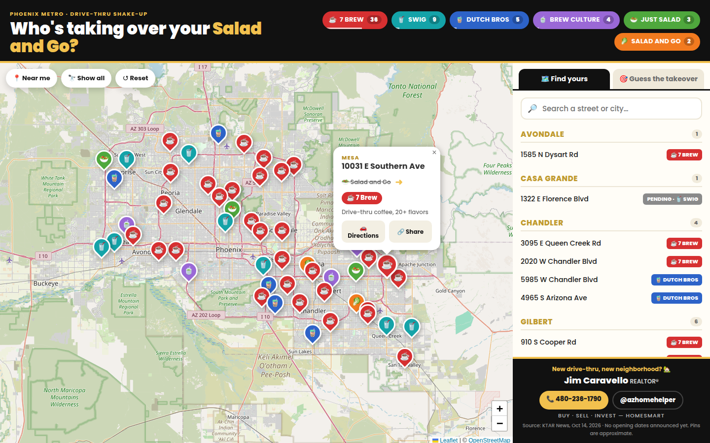
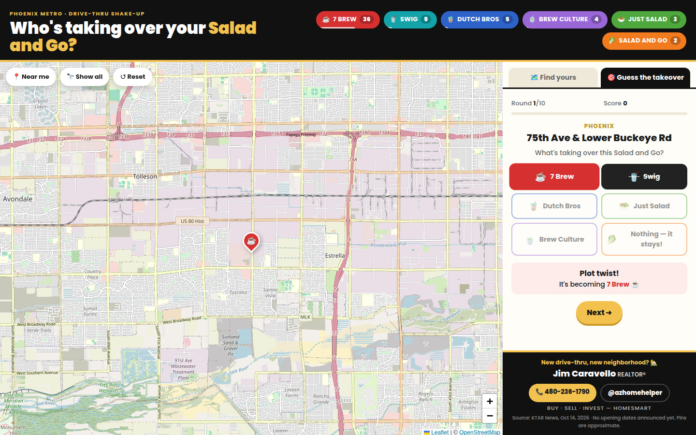

# Who's Taking Over Your Salad and Go?

An interactive map of every Phoenix-area Salad and Go and what's replacing it: 7 Brew, Swig, Dutch Bros, Just Salad, Brew Culture, or nothing (a couple are staying).

**Live:** https://salad-n-go.vercel.app



## What it does

- **Map**: every location as a pin colored by brand. Tap one to see what's moving in, get directions, or share the link.
- **Filters and search**: tap a brand chip to show only that brand, or search by street or city.
- **Near me**: shows the three locations closest to you.
- **Guess the Takeover**: a 10-round game. A mystery pin drops on the map and you guess the brand.



## Running it locally

```bash
npm install
npm run dev
```

Built with [Vite](https://vite.dev) and [Leaflet](https://leafletjs.com), using OpenStreetMap tiles. It's a static site deployed on Vercel.

## Data

Locations come from KTAR News (Oct 14, 2026). No opening dates have been announced yet. The list is in `scripts/locations.raw.json`. `npm run geocode` turns it into map coordinates in `src/locations.json` using OpenStreetMap. A few pins were placed by hand at the nearest intersection, so treat pin positions as approximate.

Not affiliated with Salad and Go or any of the brands listed.
